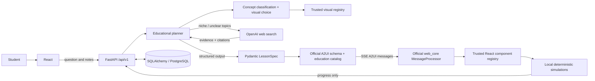

# A2UI Interactive Learning Lab

A local educational agent prototype with React, FastAPI, the official A2UI web core, and PostgreSQL in Docker. Students can explore binary search, SQL JOINs, and gradient descent, then continue a conversation and restore saved lessons.

**Demo mode is the default.** It uses labelled, curated examples. AI mode uses OpenAI structured outputs to select and configure trusted components, including general explanation, equation, graph, table, and quiz components. An absent key never silently switches an AI request to a canned answer.

## Start with Docker

Install Docker Desktop with its Linux container engine enabled. From this repository:

```powershell
Copy-Item .env.example .env
docker compose up --build -d
docker compose ps
```

Open http://localhost:5173. API documentation: http://localhost:8000/docs.
The backend runs Alembic migrations before starting. PostgreSQL has a persistent named volume and no published host port. Frontend and backend ports bind to loopback. Stop with `docker compose down`; omit `-v` to retain your data.

## Direct Windows development

Node 22+ and Python 3.12 are required. The existing `.venv` is supported:

```powershell
.\.venv\Scripts\Activate.ps1
python -m pip install -r backend\requirements.txt
cd backend
python -m uvicorn app.main:app --reload --host 127.0.0.1 --port 8000
```

In another terminal:

```powershell
cd frontend
npm ci
npm run dev
```

This path defaults to a local SQLite file, so the application can be exercised without Docker. The database and `.venv` are ignored by Git. For direct AI development, copy `backend/.env.example` to `backend/.env`, add your API key there, and restart the backend. This template sets `DEMO_MODE=false`. Compose reads the root `.env`. Keep the frontend key-free.

## Configuration

| Variable | Default | Purpose |
| --- | --- | --- |
| `DEMO_MODE` | `true` | Explicit curated example mode; set `false` for real AI composition |
| `OPENAI_API_KEY` | empty | Required in AI mode, backend only |
| `OPENAI_MODEL` | `gpt-6-luna` | Configurable model supporting structured outputs and reasoning effort |
| `OPENAI_REASONING_EFFORT` | `low` | `none`, `low`, `medium`, or `high`; low is the initial cost/quality tradeoff |
| `MODEL_TIMEOUT` | `45` | Model request timeout in seconds |
| `DATABASE_URL` | `sqlite:///./learning.db` | Direct development; Compose supplies PostgreSQL |
| `POSTGRES_PASSWORD` | `local-learning-only` | Local Compose database password; use URL-safe characters |

To use AI mode, set `DEMO_MODE=false` and your key, then run `docker compose up -d --build backend`. Lecture notes and recent conversation context are sent to the configured model. The model can use OpenAI web search for niche or ambiguous named topics, builds lessons from retrieved evidence, and displays citations when the search response includes them. This adds $10 per 1,000 web-search calls, plus model token charges for retrieved content; familiar questions need not trigger a search. Notes quotes must match the supplied text exactly. The model may still make educational mistakes; this is a prototype, not a vetted curriculum.

The default is GPT-6 Luna with low reasoning effort and a 6,000-token output ceiling (including reasoning). As checked on 2026-11-02, its standard rates are $0.10 per million input tokens and $0.50 per million output tokens. An example request using 3,000 uncached input tokens and 1,500 total billed output tokens costs $0.00105, or about $1.05 per 1,000 such requests. Actual notes, history, reasoning, retries, taxes and service-tier choices can change the total. This is an estimate, not a measured lesson cost or a spending cap. See [official model pricing and capabilities](https://developers.openai.com/api/docs/models/gpt-6-luna). Account access and lesson quality must be checked with a live API key.

## Architecture



* `backend/app/agents/planner.py`: model request, context, explicit demo planner.
* `backend/app/schemas/lesson.py`: bounded lesson specification, visual plan, citation references, and semantic visual checks.
* `backend/app/a2ui/`: official vendored v0.9.1 schemas, catalog, validation and serializer.
* `backend/app/db/` and `backend/migrations/`: conversations, messages, current generated lesson, simulation state and revision.
* `backend/app/services/progress.py`: component-specific state validation.
* `frontend/src/a2ui/`: official processor integration and React adapter.
* `frontend/src/components/`: trusted components, including interactive process flows, decision trees, timelines, and comparison matrices.
* `frontend/src/simulations/`: deterministic binary search, relational joins, and quadratic gradient descent.

No model-generated source code is evaluated. React renders text safely. The agent chooses composition; the trusted application implements simulation behavior. Binary search validates sorted input, supports targets and playback. JOINs include duplicate matches and unmatched records. Gradient descent uses `L(x)=x²` and explains convergence, oscillation, and divergence.

In AI mode, each lesson includes a concept classification and a required visual-form plan. The plan must match an included trusted component. Process flows and timelines support step navigation, decision trees support clicking branches and tracing outcomes, and comparison matrices let learners focus either subject. Structural checks reject mismatched plans, disconnected flows, invalid trees, malformed comparisons, unsorted binary-search data, and ungrounded source references. Web citations are attached to the visual cards they support.

## A2UI integration

Targets [A2UI v0.9.1](https://a2ui.org/specification/v0.9.1-a2ui/) and pins `@a2ui/web_core` to `0.15.0`. The custom React adapter delegates surface lifecycle, component storage, and data model processing to the official library. It does not implement a substitute wire protocol. The allowlisted catalog identifier is `urn:a2ui-learning-lab:education:v1`, exposed at `/api/v1/catalog`.

The backend validates every emitted `createSurface`, `updateComponents`, `updateDataModel`, and `deleteSurface` message against the official JSON schemas and the education catalog. It retains upstream schema IDs. Follow-ups update the existing surface; restoring a conversation emits a complete creation snapshot. Local state is held in the official surface data model and persisted separately from chat.

The question endpoint accepts `?stream=true` for SSE: a `lesson` metadata event, `a2ui` events containing protocol messages, then `done`. Planning finishes and validates before any message is emitted; this is progressive delivery of validated messages, not token-by-token LLM streaming. JSON REST responses wrap protocol messages in application metadata. The SSE transport uses `text/event-stream`; individual A2UI messages follow the v0.9.1 schema.

## API

| Method and route | Purpose |
| --- | --- |
| `GET /api/v1/health` | Database connectivity, mode and protocol |
| `GET /api/v1/catalog` | Education component catalog |
| `POST /api/v1/conversations` | Start a local demo conversation |
| `GET /api/v1/conversations` | Recent sessions |
| `GET /api/v1/conversations/{id}` | Restore messages, notes and lesson |
| `POST /api/v1/conversations/{id}/questions` | Generate or update a lesson; body `{question, notes?}` |
| `GET /api/v1/lessons/{id}` | Current specification and A2UI snapshot |
| `PUT /api/v1/lessons/{id}/progress` | Save validated component state |
| `POST /api/v1/conversations/{id}/actions` | Official A2UI client action envelope; allowlisted `explain_further` |
| `DELETE /api/v1/lessons/{id}` | Delete lesson and emit `deleteSurface` |

Errors use `{ "error": { "message": "..." } }`. Request bodies are capped at 100 KB; question and note limits are 4,000 and 20,000 characters. Model output size, timeout, retries and component counts are bounded. No authentication is implemented: every local user shares the clearly named `local-demo` owner. For integration, add authenticated ownership checks to every query, distributed concurrency/rate controls, and a deployment-specific CORS policy or same-origin proxy.

## Verification

```powershell
cd backend
..\.venv\Scripts\python.exe -m pytest -q
cd ..\frontend
npm test
npm run build
npx playwright install chromium
# Start the backend on port 8000 before this command:
npm run test:e2e
```

Tests cover API persistence, protocol schema rejection, same-surface follow-ups, SSE, progress, explicit AI configuration, a mocked structured-output client, deterministic simulations, React interactions and a real browser flow. AI integration tests do not call a paid model.

Verified locally: 10 backend tests, 8 frontend tests, 2 Chromium end-to-end scenarios, the TypeScript/Vite production build, and an Alembic upgrade/rollback against a temporary SQLite database. The browser scenarios include all three visualizers, a topic change within one conversation, restoration, and mobile overflow checking. The supplied GitHub Actions workflow additionally starts the Docker stack so PostgreSQL can be exercised in CI; that workflow has not been run from this workspace.

## Add a component

1. Add a trusted React implementation and register it in `frontend/src/components/LearningComponents.tsx` (or extract a dedicated component file).
2. Extend the allowlist in `frontend/src/types/lesson.ts` and `backend/app/schemas/lesson.py`. Add semantic validation for its inputs. The backend catalog derives from that schema; the frontend registry provides an additional allowlist check.
3. Document the component's configuration and limitations in the planner instruction. Never accept code, arbitrary function names, or raw HTML.
4. Add deterministic simulation functions where needed, define allowed progress fields in `services/progress.py`, and test correctness, rendering and protocol validation.
5. Version the catalog when making incompatible changes, so saved lessons remain interpretable.

## Three-minute CTO demonstration

* **0:00–0:30:** Point out the mode badge. In AI mode, ask for an interactive binary-search explanation. Explain that the model selected the components and configured their inputs.
* **0:30–1:10:** Step through the array, change the target, play and reset. These interactions run locally without model calls.
* **1:10–1:40:** Ask what happens when the target is absent. Show the existing surface update and inspect its A2UI messages.
* **1:40–2:10:** Open SQL JOINs and switch to LEFT JOIN. Show the preserved row and NULL. Open gradient descent, change the learning rate to 1.1 and show divergence.
* **2:10–2:35:** In AI mode, paste a short set of notes and ask a related question. Show the verified quote when generated and a general-topic lesson using ordinary components.
* **2:35–3:00:** Reload and restore a session. Open `/docs`, identify the question and action endpoints, and explain the renderer/catalog boundary for an EdTech integration.

In demo mode explicitly describe composition as predetermined. General-question generation and notes-grounded explanations require AI mode.

## Current limitations

* Docker/PostgreSQL startup could not be exercised on the development machine because Docker is unavailable. Compose, health checks and migrations are supplied; SQLite is the tested local persistence path.
* A live OpenAI request has not been verified with a configured key. The real structured-output implementation is covered using a mocked SDK response.
* The latest lesson replaces the previous specification within a conversation; historical chat is retained, but historical lesson versions are not stored separately.
* PDF upload, authentication, distributed workers, curriculum review and multi-user isolation are outside this local MVP.
* `npm audit` reports an upstream Zod collection-size advisory affecting Zod 3 and the official A2UI core that depends on it. No compatible upstream fix is currently offered by npm. Input/message size limits and allowlist validation reduce exposure; resolve or independently assess this before a public deployment. The test runner was upgraded to remove its fixable advisories.
* The production frontend bundle includes the core protocol engine and chart library; it is functional but could benefit from lazy loading before deployment at scale.

References: [official renderer guidance](https://a2ui.org/guides/renderer-development/), [OpenAI structured outputs](https://developers.openai.com/api/docs/guides/structured-outputs).
